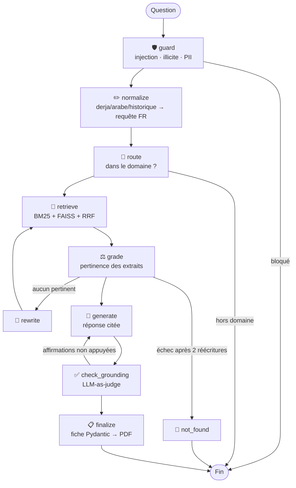

# 🇹🇳 SANAD — Assistant IA agentique pour les démarches administratives tunisiennes

> **SANAD** (سند, « appui ») répond aux questions sur les démarches administratives et juridiques
> tunisiennes **en français, en arabe et en dialecte tunisien (derja)**. Ses réponses sont **sourcées,
> vérifiées et actionnables**. Il tourne **100 % en local** : aucune donnée citoyen n'est envoyée dans le cloud.

```
Utilisateur : kifech nekhou passeport? chnowa el wra9 elli lazmin?
SANAD       : Pour obtenir un passeport biométrique, déposez la demande au poste de police de votre
              lieu de résidence [1]. Documents : CIN valide, photos récentes sur fond clair, timbre
              fiscal (montant à vérifier), ancien passeport en cas de renouvellement [2]…
              🟢 Réponse sourcée · Fiabilité 95 % · 📋 Fiche PDF téléchargeable
```

## Pourquoi ce projet est différent d'un « chat avec ses PDF »

| Problème d'un RAG classique | Solution dans SANAD |
|---|---|
| Ne comprend pas la derja (« dhayya3t el carta ») | Détection de langue + glossaire derja + **agent de normalisation** |
| Récupère des documents hors sujet | **Corrective RAG** : un agent note la pertinence et **réécrit la requête** si besoin |
| Hallucine des montants / délais | **Vérificateur de faits (LLM-as-judge)** + **régénération stricte** + citations `[n]` validées |
| Rate les termes exacts (« SUARL », « 2018-52 ») | **Recherche hybride BM25 + FAISS** fusionnée par **Reciprocal Rank Fusion** |
| Vulnérable aux injections de prompt | **Garde-fous** FR/EN/AR, filtrage des demandes illicites, refus hors domaine |
| Fuite de données personnelles | Masquage **CIN / téléphone / e-mail**, LLM **local** (Ollama) |
| Réponse en texte libre | **Fiche démarche structurée (Pydantic)** exportée en **PDF FR/AR** |
| « Ça a l'air de marcher » | **Évaluation chiffrée** vs baseline : hit@k, faithfulness, correctness, refus, latence |

## Architecture (LangGraph)



Chaque nœud a un **repli déterministe** : si le LLM échoue, le glossaire derja, la recherche hybride
et les garde-fous continuent de fonctionner.

## Stack technique

| Couche | Outils |
|---|---|
| LLM local | **Ollama** — `qwen2.5:7b` (multilingue, bon en arabe) ou `llama3.2:3b` |
| Embeddings | `bge-m3` (multilingue FR/AR, 1024 dimensions) |
| Orchestration | **LangChain**, **LangGraph** (graphe d'états avec boucles) |
| Recherche | **FAISS** (dense) + **BM25** (`rank-bm25`) + RRF |
| Sorties structurées | **Pydantic v2** (`with_structured_output`) |
| Service | **FastAPI** (`/ask`, `/checklist/pdf`, `/health`, `/graph`) |
| Interface | **Streamlit** (chat, sources, raisonnement de l'agent, téléchargement PDF) |
| PDF | ReportLab + `arabic-reshaper` + `python-bidi` (arabe RTL) |
| Qualité | **pytest** (90 tests avec LLM simulé), GitHub Actions, Docker Compose |

## Structure

```
sanad/
├── sanad/
│   ├── config.py          # paramètres (.env)
│   ├── llm.py             # ChatOllama / OllamaEmbeddings
│   ├── text.py            # normalisation FR/AR + tokenisation BM25
│   ├── derja.py           # détection de langue + glossaire derja
│   ├── guardrails.py      # injections, contenus illicites, PII, citations
│   ├── ingest.py          # chargement .md/.txt/.pdf, découpage, index FAISS + BM25
│   ├── retriever.py       # recherche hybride + Reciprocal Rank Fusion
│   ├── prompts.py         # prompts de chaque agent
│   ├── schemas.py         # modèles Pydantic (LLM + API)
│   ├── graph.py           # graphe LangGraph (Corrective RAG + auto-vérification)
│   └── checklist_pdf.py   # export PDF FR/AR
├── api/main.py            # FastAPI
├── app/streamlit_app.py   # interface web
├── eval/evaluate.py       # SANAD vs RAG naïf
├── data/docs/             # corpus (démo → à remplacer par des sources officielles)
├── data/eval/questions.jsonl  # 30 questions : FR, AR, derja, hors domaine, injections
├── tests/                 # 90 tests unitaires et d'intégration (sans Ollama)
├── Dockerfile · docker-compose.yml
└── scripts/setup_windows.ps1 · setup_linux.sh
```

## Installation

**Prérequis :** Python 3.11+ et [Ollama](https://ollama.com). Comptez environ 8 Go de RAM pour `qwen2.5:7b`.
Sur une petite machine, mettez `SANAD_LLM=llama3.2:3b` dans `.env`.

```bash
python -m venv .venv
.venv\Scripts\activate            # Windows  (Linux/macOS : source .venv/bin/activate)
pip install -r requirements.txt
copy .env.example .env            # Linux/macOS : cp .env.example .env

ollama pull qwen2.5:7b
ollama pull bge-m3

python -m sanad.ingest            # construit l'index FAISS + BM25
pytest -q                         # 90 tests, sans Ollama
streamlit run app/streamlit_app.py
```

API : `uvicorn api.main:app --reload`, puis http://localhost:8000/docs

```bash
curl -X POST localhost:8000/ask -H "Content-Type: application/json" \
     -d '{"question": "kifech nekhou passeport?", "checklist": true}'
```

Docker (Ollama, téléchargement des modèles, index, API et UI) : `docker compose up --build`.
Ensuite, l'UI est sur http://localhost:8501 et l'API sur http://localhost:8000/docs.

## Évaluation

```bash
python -m eval.evaluate              # SANAD vs baseline sur 30 questions
python -m eval.evaluate --limit 10   # test rapide
SANAD_JUDGE=qwen2.5:14b python -m eval.evaluate   # juge plus puissant (recommandé)
```

Le script compare SANAD à un **RAG naïf** (recherche dense seule, sans garde-fous, sans derja,
sans auto-correction). Il écrit `eval/results/report.md` :

| Métrique | Baseline | SANAD |
|---|---|---|
| Hit@6 (retrieval) | _à mesurer_ | _à mesurer_ |
| Faithfulness | _à mesurer_ | _à mesurer_ |
| Correctness (FR / AR / derja) | _à mesurer_ | _à mesurer_ |
| Refus corrects (hors domaine + injections) | _à mesurer_ | _à mesurer_ |
| Latence moyenne | _à mesurer_ | _à mesurer_ |

> Collez ici vos propres résultats après exécution.

## Ajouter ses propres documents

Déposez des `.md`, `.txt` ou `.pdf` dans `data/docs/`, puis relancez `python -m sanad.ingest`.
Pour les fichiers Markdown, l'en-tête YAML (`title`, `organisme`) est utilisé dans les citations.

## Limites et éthique

- Le corpus fourni est **une démonstration**. Les montants et délais sont marqués « à vérifier ».
  Avant un usage réel, il faut le remplacer par des sources officielles.
- SANAD est un outil d'orientation et ne remplace pas l'administration. Chaque réponse cite ses sources,
  et SANAD refuse de répondre plutôt que d'inventer.
- Le juge LLM peut se tromper. Utilisez un modèle plus grand comme juge (`SANAD_JUDGE`) et vérifiez
  un échantillon à la main.

## Auteur

**Yassine Ben Amor**. Projet réalisé après la formation *Generative AI & LLMs — NVIDIA certified* (GOMYCODE, 2025).
